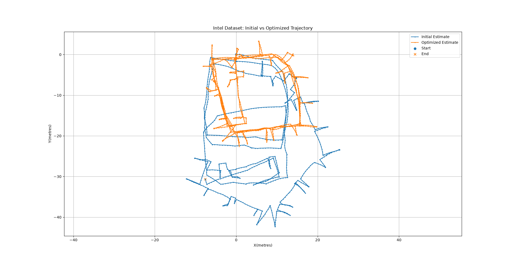

# 2D Pose Graph SLAM using GTSAM

A C++ implementation of "2D Pose Graph Simultaneous Localization and Mapping (SLAM)" using the GTSAM library. This project uses the Intel Research Lab dataset in the .g2o format to construct a nonlinear factor graph and optimize the robot trajectory using nonlinear least squares.

## Overview

Pose Graph SLAM is a graph-based approach to simultaneous localization and mapping in which robot poses are represented as nodes and spatial constraints between poses are represented as edges.
The objective is to estimate the most likely robot trajectory by minimizing the error across all available constraints.
In this project, I implemented a 2D pose graph optimization pipeline using GTSAM, including:

- Parsing pose and constraint data from a .g2o dataset.
- Representing robot poses using Pose2.
- Constructing a nonlinear factor graph.
- Adding prior and relative pose constraints.
- Initializing pose estimates.
- Optimizing the graph using the Levenberg–Marquardt algorithm.
- Exporting initial and optimized trajectories for visualization.

## Technologies Used

C++ | Python | GTSAM | CMake |  Pandas | Matplotlib

## Dataset

This project uses the "Intel Research Lab 2D SLAM dataset", provided in the .g2o format.

The dataset contains:

- VERTEX_SE2: Contains a pose ID and its initial 2D pose estimate ((x,y,theta)).
- EDGE_SE2: Contains two pose IDs, their relative transformation, and the associated information matrix.
  
The dataset is used to construct the nonlinear factor graph.

Dataset reference: https://github.com/RainerKuemmerle/g2o

## Implementation

### 1. Dataset Parsing

The .g2o file is parsed line by line to identify vertex and edge entries.

### 2. Factor Graph Construction

The graph is constructed using GTSAM's NonlinearFactorGraph.
Robot poses are represented using Pose2 and uniquely identified using GTSAM symbols.
The graph consists of:
- **Prior factors:** Anchor the graph to a reference pose and remove gauge freedom.
- **Between factors:** Encode relative pose constraints between connected robot poses.

### 3. Initial Estimates

Initial pose estimates are stored in GTSAM's 'Values' container.
These estimates provide the starting point for nonlinear optimization.

### 4. Nonlinear Optimization

The constructed factor graph is optimized using the Levenberg–Marquardt optimizer.

### 5. Trajectory Visualization

Initial and optimized pose estimates are exported to CSV files.
A Python script using Matplotlib is used to visualize and compare the trajectories.

## Project Structure

```text
pose_graph_slam/
│
├── src/
│   └── main.cpp
│
├── data/
│   └── input_INTEL_g2o.g2o
│
├── results/
│   └── trajectory_comparison.png
│
├── plot.py
├── CMakeLists.txt
├── .gitignore
└── README.md
```

## Installation and Dependencies

The project requires:

- C++ compiler supporting C++11 or later.
- CMake.
- GTSAM.
- Python 3.
- Matplotlib.

## Building the Project

Clone the repository:
```bash
git clone https://github.com/YOUR_USERNAME/pose-graph-slam-gtsam.git
cd pose-graph-slam-gtsam
```
Create a build directory:
```bash
mkdir build
cd build
```
Configure and compile:
```bash
cmake ..
cmake --build . -j$(nproc)
```
## Running the Project

From the build directory, execute:
```bash
./pose_graph_slam
```
## Visualizing Results

After running the C++ executable, navigate to the project root and execute:
```bash
python3 plot.py
```
The visualization compares the initial trajectory against the optimized trajectory.

## Results

The optimization produces a refined estimate of the robot's trajectory by minimizing the error associated with the pose constraints.

Initial vs. Optimized Trajectory



## Acknowledgements

- [GTSAM – Georgia Tech Smoothing and Mapping Library](https://gtsam.org/)


**Project:** 2D Pose Graph SLAM using GTSAM
**Language:** C++ / Python
**Domain:** Robotics, State Estimation, SLAM, Nonlinear Optimization
